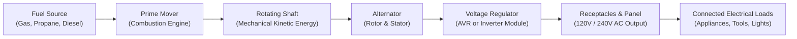
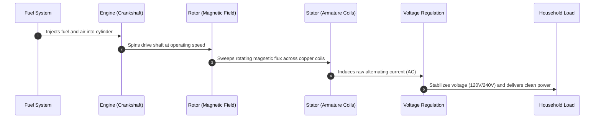
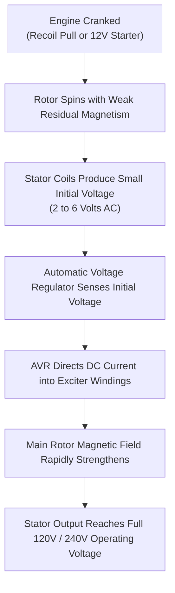
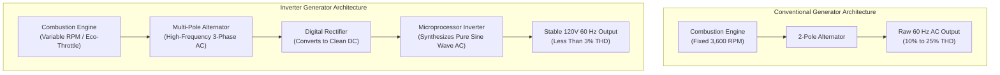
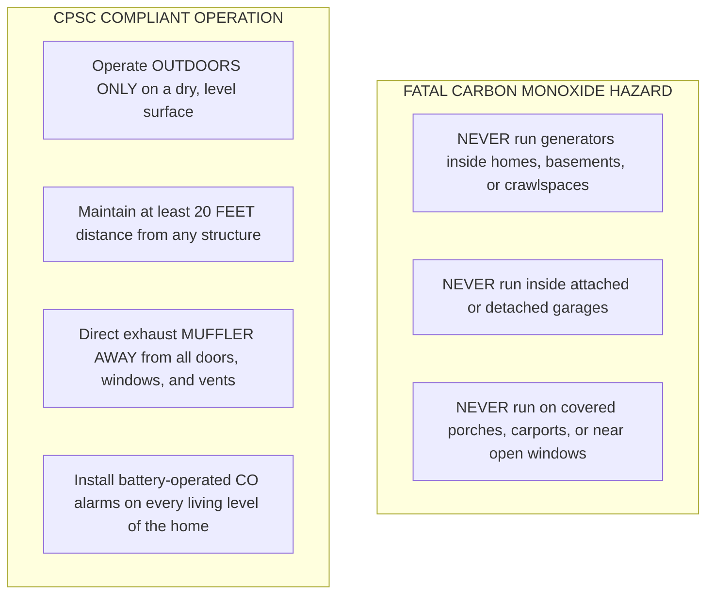

# Editorial Draft: How Does a Generator Work?

> **Document Status:** Complete Pre-Release Draft (Unpublished)  
> **Target Release Window:** Post-Freeze (After November 1, 2026)  
> **Proposed Future Route:** `/how-does-a-generator-work` (Not active in application routing or sitemap)  
> **Target Topical Cluster:** `generators` (Generators & Outage Backup)  
> **Parent Interactive Tool:** [`/generator-size-calculator`](https://calcmypower.com/generator-size-calculator)  
> **Companion Editorial Guides:** [`/how-much-gas-does-a-generator-use`](https://calcmypower.com/how-much-gas-does-a-generator-use), [`/what-size-generator-do-i-need-for-my-house`](https://calcmypower.com/what-size-generator-do-i-need-for-my-house), [`/what-size-generator-to-run-a-refrigerator`](https://calcmypower.com/what-size-generator-to-run-a-refrigerator), [`/continuous-power-generators`](https://calcmypower.com/continuous-power-generators)  

---

## SEO Specification & Metadata

- **Primary Keyword:** `how does a generator work` (US Search Volume: 3,600 | KD: 25)
- **Secondary Supporting Keywords:**
  - `how does an electric generator work` (US Search Volume: 320 | KD: 27)
  - `how does a portable generator work` (US Search Volume: 260 | KD: 26)
  - `how does a generator work without electricity` (US Search Volume: 50 | KD: 1)
  - `how does a generator work step by step` (US Search Volume: 20 | KD: Unranked)
- **Search Intent:** Informational and conceptual educational intent. Users want an accessible, technically accurate explanation of how mechanical energy becomes usable alternating current (AC) electricity, how portable and inverter models operate, and how units generate power without grid electricity.
- **Suggested Article Title (H1):** How Does a Generator Work? Engine, Alternator, and Electricity Explained
- **Proposed Meta Title:** How Does a Generator Work? Engine, Alternator & Power Explained
- **Proposed Meta Description:** Learn how generators convert mechanical motion into electricity through electromagnetic induction. Explore engines, alternators, inverters, and safe operation.
- **Reading Time:** Approximately 10 minutes (1,850 words)
- **Target Audience:** US homeowners preparing for storm outages, RV owners, campers, jobsite operators, and curious readers seeking an engineering explanation without academic jargon.

---

# How Does a Generator Work? Engine, Alternator, and Electricity Explained

An electric generator does not create electricity out of thin air. Instead, it converts mechanical energy into electrical energy using the scientific principle of electromagnetic induction.

A combustion engine burns fuel to spin a shaft. That spinning shaft turns a magnet inside insulated copper wire coils within an alternator. The moving magnetic field forces electrons through the wire, producing electrical current.

---

## The Core Principle: Electromagnetic Induction Explained

Generators operate on the law of conservation of energy. Energy cannot be created or destroyed, only transformed from one state to another.

In 1831, British scientist Michael Faraday discovered electromagnetic induction. He proved that moving a magnet through a closed coil of copper wire causes an electric current to flow.

When a magnetic field sweeps across a stationary electrical conductor, it exerts physical force on the electrons in that metal. This movement creates an electrical potential difference, measured in volts.

When you connect an appliance to complete the circuit, those displaced electrons flow through the wire as current, measured in amps. The strength of the generated voltage depends on three factors:

1. The speed at which the magnetic field rotates past the wire coils.
2. The strength of the magnetic field.
3. The number of wire loops bundled inside the coils.

Because the mechanical shaft turns continuously, the magnetic polarity switches back and forth with every rotation. This continuous reversal produces alternating current (AC), the same form of electricity delivered by the utility grid.

---

## How a Generator Works Step by Step

Every engine-driven electrical generator transforms energy through five sequential stages:

### 1. Fuel Powers the Prime Mover
The process begins when an internal combustion engine burns fuel such as gasoline, liquid propane, or diesel. Piston movement inside the engine cylinder turns a steel crankshaft, generating mechanical rotational energy.

### 2. The Rotating Shaft Drives the Alternator
The engine crankshaft connects directly or through a tapered coupler to the alternator rotor shaft. In conventional portable generators, the engine rotates this shaft at 3,600 revolutions per minute (RPM) to maintain a steady 60-Hertz (Hz) electrical frequency.

### 3. The Rotor Generates a Moving Magnetic Field
The rotor sits inside the alternator and acts as a rotating electromagnet or permanent magnet assembly. As the rotor spins, its North and South magnetic poles sweep past stationary coils at high speed.

### 4. The Stator Induces Usable Electric Current
The stator is a stationary cylinder constructed of laminated steel slotted with tightly wound copper coils. When the rotor magnetic flux cuts across these stator windings, electromagnetic induction pushes electrons through the copper, creating alternating current.

### 5. Controls Regulate Voltage and Deliver Power
Raw electrical output passes through an automatic voltage regulator (AVR) or a digital inverter module. The system stabilizes output at 120 volts or 240 volts before sending power to panel receptacles, circuit breakers, and connected home appliances.

---

## Main Generator Components and Architecture

A generator combines mechanical, electrical, thermal, and electronic systems into a single self-contained power plant.

| Component | Primary Function | System Role | Design Variations |
| :--- | :--- | :--- | :--- |
| **Engine (Prime Mover)** | Burns fuel to deliver rotational mechanical power | Mechanical Drive | Single-cylinder OHV (portable) to multi-cylinder V-twin or liquid-cooled inline (standby) |
| **Alternator (Rotor & Stator)** | Converts rotating mechanical motion into alternating current | Electrical Conversion | Brushed with slip rings, brushless exciter, or flywheel-integrated multi-pole assembly |
| **Voltage Regulator (AVR)** | Adjusts rotor excitation current to maintain constant voltage | Power Regulation | Analog electronic PCB, carbon brush AVR, or microprocessor inverter controller |
| **Fuel System** | Stores and meters fuel into the combustion chamber | Fuel Delivery | Carbureted gasoline tank, multi-fuel LPG/gasoline regulator, or piped natural gas line |
| **Cooling & Exhaust System** | Dissipates combustion heat and expels toxic exhaust gases | Thermal & Life Safety | Forced-air cooling fan, engine radiator, spark-arresting muffler, and exhaust pipe |
| **Lubrication System** | Circulates oil to minimize engine bearing and cylinder wear | Engine Protection | Splash lubrication (small portables) or pressurized oil pump with spin-on filter (standby) |
| **Control Panel & Outlets** | Provides user interface, metering, and circuit protection | Power Distribution | Duplex 120V 20A receptacles, 120/240V twist-lock outlets, USB ports, and push breakers |

The engine and alternator are the two non-negotiable core assemblies. Without the engine, there is no mechanical input; without the alternator, there is no electrical output.

---

## How Does a Generator Work Without Grid Electricity?

Many homeowners wonder how a generator creates electricity when the regional power grid is completely dark. A portable generator functions as an isolated electrical island. It produces its own current using internal magnetism.

When a generator sits idle in storage, its rotor iron core retains a faint residual magnetic field. Engineers call this magnetic remanence.

When you pull the recoil cord or press the start button, the engine begins spinning the rotor. This weak residual field cuts across the stator windings, inducing a small initial voltage of 2 to 6 volts.

The automatic voltage regulator detects this tiny voltage and directs direct current (DC) into the exciter windings. That current strengthens the rotor electromagnet, which in turn induces more voltage in the stator.

Within a fraction of a second, this self-excitation loop builds until the generator reaches its full 120-volt or 240-volt output. Small inverter generators use high-strength permanent magnets embedded in the flywheel, eliminating the need for electrical excitation coils altogether.

Manual recoil pull-start generators require no battery at all. Pulling the cord spins the engine, while a built-in magneto powers the spark plug independently. Electric-start models use a small 12-volt onboard battery solely to turn the starting motor.

---

## Conventional Generators vs. Inverter Generators

While both designs use electromagnetic induction, conventional and inverter generators manage engine speed and electrical output differently.

### Conventional Synchronous Generators
In a conventional generator, AC frequency is locked to engine speed. In North America, household electricity alternates at 60 cycles per second (60 Hz).

To produce 60-Hz power with a standard two-pole alternator, the engine must spin at exactly 3,600 RPM ($60 \times 60 = 3,600$). If the engine slows to 3,300 RPM under heavy load, the frequency drops to 55 Hz, which can cause electric motors to overheat.

A mechanical governor opens the throttle when electrical load increases to keep the engine spinning at 3,600 RPM. Because the engine runs at full speed even when powering a single lamp, conventional units consume more fuel and create higher background noise.

Their raw AC waveform often carries Total Harmonic Distortion (THD) of 10 to 25 percent. This electrical distortion is harmless for basic heating elements and jobsite saws, but it can stress sensitive electronics.

### Inverter Generators
Inverter generators decouple electrical frequency from engine speed using a multi-step digital conversion process.

The engine spins a compact multi-pole alternator integrated directly into the flywheel. This produces raw, high-frequency three-phase AC electricity across a wide range of engine speeds.

Next, a solid-state rectifier converts that raw AC into direct current (DC). Finally, a microprocessor-controlled inverter circuit converts the DC back into smooth, pure sine wave AC electricity at 120 volts and precisely 60 Hz.

Because the microprocessor synthesizes the output frequency electronically, the engine does not need to run at 3,600 RPM. An electronic throttle drops engine speed to an idle when demand is low, throttling up only when heavy appliances turn on.

| Characteristic | Conventional Portable Generator | Inverter Generator |
| :--- | :--- | :--- |
| **Output Waveform Quality** | Modified sine wave with 10% to 25% THD | Pure sine wave with under 3% THD |
| **Engine Speed Behavior** | Fixed speed (constant 3,600 RPM) | Variable speed (throttles to load demand) |
| **Fuel Efficiency** | Moderate (burns fuel at high RPM continuously) | High (up to 30% to 40% fuel savings at light loads) |
| **Operating Noise Level** | Loud (typically 68 to 76 dBA at 23 feet) | Quiet (typically 52 to 62 dBA at 23 feet) |
| **Weight and Portability** | Heavier steel frame with large copper windings | Lightweight suitcase enclosure with compact flywheel |
| **Purchase Cost** | Economical per watt of output | Higher initial cost per watt of output |
| **Suitability for Sensitive Gear** | Best for tools, pumps, and resistive loads | Essential for laptops, TVs, medical units, and variable-speed appliances |

---

## Portable, Standby, and RV Generators: Key Operational Differences

Generators share the same electromagnetic core, but their installation and switching mechanisms vary based on application.

```mermaid
flowchart TD
    subgraph Portable["Portable Generator Setup"]
        P1["Manual Rollout to Yard<br>(At Least 20 Feet from House)"] --> P2["Heavy-Duty Extension Cords<br>or Generator Inlet Box"]
        P2 --> P3["Manual Transfer Switch<br>or Dedicated Outlets"]
    end

    subgraph Standby["Permanent Standby Setup"]
        S1["Permanently Bolted Pad<br>(Piped Natural Gas or Propane)"] --> S2["Automatic Transfer Switch (ATS)<br>(Monitors Utility Grid Line)"]
        S2 --> S3["Sub-Second Outage Sensing<br>Automatic Start within 10-20s"]
    end

    subgraph RV["RV Generator Setup"]
        R1["Onboard Compartment Mount<br>(Vibration Dampened)"] --> R2["Direct RV Fuel Tank Feed<br>(Gasoline or Diesel)"]
        R2 --> R3["30A / 50A RV Distribution Panel"]
    end
```

### Portable Generators
Portable generators feature wheels and handles for manual transport. They store gasoline in an onboard tank and deliver electricity through faceplate receptacles.

Homeowners deploy portable units outdoors during emergencies. They connect appliances using heavy-duty outdoor cords or plug into an outdoor power inlet box wired to a manual transfer switch.

To calculate how much gasoline a portable generator uses under load, review our [Generator Fuel Consumption Guide](https://calcmypower.com/how-much-gas-does-a-generator-use) or estimate operating hours with our [Generator Fuel Consumption Calculator](https://calcmypower.com/generator-fuel-consumption-calculator).

### Standby Home Generators
Standby generators sit permanently on a concrete or composite pad outside the home. They connect directly to the home electrical service through an Automatic Transfer Switch (ATS).

These units connect to a municipal natural gas line or a large buried propane tank, eliminating manual refueling during storms. When utility power fails, the transfer switch senses voltage loss, signals the generator to start, and transfers electrical circuits within 10 to 20 seconds.

When utility power returns, the system reverses the connection and cools down the engine automatically. Sizing a standby system requires evaluating continuous household demand and motor startup surges, as detailed in our guide on [What Size Generator Do I Need for My House?](https://calcmypower.com/what-size-generator-do-i-need-for-my-house).

### RV and Mobile Generators
RV generators are compact units engineered to fit into exterior vehicle compartments. They tap directly into the motorhome primary fuel tank and incorporate specialized mufflers to reduce campsite noise.

They supply 120-volt 30-amp or 120/240-volt 50-amp electricity to run rooftop air conditioners, microwaves, and onboard battery converters while camping off-grid.

---

## What Happens When You Connect an Electrical Load?

A generator does not run under the same physical resistance when powering a lightbulb as it does when running a central air conditioner. Electrical load creates physical mechanical resistance on the engine shaft.

When you plug in an appliance and switch it on, current begins flowing through the stator copper windings. According to Lenz's law, this electrical current generates its own opposing magnetic field.

This opposing field pushes back against the spinning rotor electromagnet, creating counter-electromotive torque. The rotor resists rotation, which acts like an invisible brake on the engine crankshaft.

The engine encounters mechanical drag and begins to slow down. An engine governor detects the drop in RPM and immediately opens the throttle plate, injecting more fuel and air into the combustion chamber.

The engine combusts more fuel, produces more horsepower, and restores normal operating speed. This is why a generator changes tone and grows noticeably louder when heavy appliances turn on.

### Resistive vs. Inductive Motor Loads
Electrical loads interact with generators in two distinct ways:

- **Resistive Loads:** Light bulbs, electric space heaters, toasters, and coffee makers convert electricity into heat or light. Current and voltage rise together in phase. These devices draw the same wattage when starting as they do while running.
- **Inductive Motor Loads:** Refrigerators, well pumps, air conditioners, and air compressors rely on electric motors. When an electric motor starts from a dead stop, its stationary windings create a momentary short circuit until the rotor begins spinning.

This initial motor startup draws a massive surge of inrush current lasting 1 to 3 seconds, typically 2 to 3 times the motor continuous running power.

### Worked Example: Loading a 3,500-Watt Generator
Consider a homeowner running emergency essentials on a typical 3,500-watt continuous generator:

1. **Continuous Base Load:** The home operates LED lighting (100 watts), an internet router (20 watts), and a television (150 watts), totaling 270 watts. The engine idles smoothly under minimal counter-torque.
2. **Refrigerator Cycles On:** A kitchen refrigerator requires 700 running watts, but demands 2,100 watts for two seconds when its compressor starts.
3. **Surge Impact:** At the moment the compressor kicks on, total electrical demand spikes to $270\text{ W} + 2,100\text{ W} = 2,370\text{ W}$.
4. **Governor Response:** The engine experiences counter-electromotive torque, drops slightly in RPM, and the governor opens the throttle to supply the surge.
5. **Settled Running State:** Once the compressor reaches operating speed, demand drops to $270\text{ W} + 700\text{ W} = 970\text{ W}$. The engine settles into a steady cruising tone.

To convert between appliance operating current and wattage, use our [Watts to Amps Electrical Calculator](https://calcmypower.com/watts-to-amps-calculator). For comprehensive refrigerator startup calculations, read our guide on [What Size Generator to Run a Refrigerator](https://calcmypower.com/what-size-generator-to-run-a-refrigerator).

---

## Critical Generator Safety and Code Compliance

Combustion generators produce electrical energy alongside hazardous byproducts. Safe operation requires strict adherence to manufacturer instructions and electrical safety standards.

### 1. The 20-Foot Outdoor Placement Rule
Internal combustion engines produce exhaust containing carbon monoxide (CO). Carbon monoxide is a colorless, odorless, and tasteless gas that can cause severe injury or death within minutes.

According to the U.S. Consumer Product Safety Commission (CPSC), portable generators must operate outdoors only, positioned at least 20 feet away from homes, doors, windows, and fresh-air intake vents.

Always direct the engine exhaust muffler away from occupied structures. Never run a generator inside a home, basement, crawlspace, shed, or garage, even if doors and windows are left wide open.

### 2. Preventing Fatal Backfeeding
Never connect a portable generator directly into a standard household wall outlet using a double-male plug cord, commonly called a "suicide cord." This dangerous practice is known as backfeeding.

Backfeeding bypasses your home circuit protection and sends high-voltage electricity backward through the utility transformer. This energizes downed neighborhood power lines, presenting an electrocution hazard for utility line workers restoring power.

Safe home connection requires a dedicated transfer device installed by a licensed electrician in compliance with National Electrical Code (NEC) Article 702:

- **Manual Transfer Switch:** A dedicated subpanel that mechanically isolates selected emergency circuits from the utility grid before connecting generator power.
- **Mechanical Panel Interlock:** A steel sliding bracket installed on the main service panel that physically prevents the utility main breaker and the generator backfeed breaker from turning on simultaneously.

For details on continuous duty ratings and safe backup capacity, consult our reference on [Continuous Power Generators](https://calcmypower.com/continuous-power-generators).

### 3. Weather Protection and Safe Refueling
Operating a generator in rain or standing water introduces severe electrical shock and electrocution hazards. Operate the unit on a dry, level surface beneath an open-sided, manufacturer-approved generator tent or canopy.

Never add fuel while the engine is running or hot. Gasoline spilled on a hot engine block or exhaust muffler can ignite instantly. Turn off the generator and allow the engine to cool for at least 15 minutes before opening the fuel cap.

---

## Frequently Asked Questions

### How does a generator work step by step?
A generator works through five clear steps: an engine burns fuel to create mechanical rotation; the spinning crankshaft drives an alternator rotor; the rotor sweeps a magnetic field past stationary copper stator coils; electromagnetic induction forces electrons to move through the wire coils; and a voltage regulator stabilizes the resulting current at 120V or 240V for connected appliances.

### How does an electric generator produce electricity?
An electric generator produces electricity through electromagnetic induction, a physical principle discovered by Michael Faraday in 1831. When an electrical conductor moves through a magnetic field, the magnetic forces push electrons along the wire. A generator continuously spins magnets past tightly wound copper coils, generating a continuous flow of alternating electrical current.

### How does a portable generator work?
A portable generator combines a compact gasoline or propane engine with an alternator inside a steel frame. The engine burns fuel to rotate a drive shaft at 3,600 RPM. This spinning motion turns an electromagnetic rotor inside stator coils, inducing alternating current delivered through standard household outlets mounted on the front control panel.

### Can a generator work without grid electricity?
Yes. An engine-driven generator is a self-contained power plant that operates independently of the utility grid. It creates its initial magnetic field using residual magnetism stored in its rotor iron core or high-strength permanent magnets. A manual recoil pull cord starts the engine mechanically without requiring grid electricity or a battery.

### What is the difference between a conventional and an inverter generator?
A conventional generator runs at a fixed 3,600 RPM to maintain 60-Hz frequency, producing power with higher electrical distortion (10% to 25% THD). An inverter generator produces raw multi-phase AC, rectifies it to DC, and uses a digital microprocessor to synthesize a clean pure sine wave with under 3% THD. This allows the inverter engine to throttle down at light loads, saving fuel and reducing noise.

### How does a generator supply power to a house safely?
A generator supplies power to a house safely through a code-compliant transfer switch or mechanical panel interlock. These devices physically isolate the home electrical system from the outside utility grid before connecting generator power. This prevents deadly backfeeding onto power lines while allowing the generator to safely power household circuits from an outdoor location at least 20 feet away.

---

## Internal Linking & Context Plan

The following table documents planned internal links to live CalcMyPower tools and guides. Every destination URL has been verified in the repository registry.

| Target Route | Route Type | Proposed Anchor Text | Context & Location in Article |
| :--- | :--- | :--- | :--- |
| `/generator-size-calculator` | Calculator | `Generator Size Calculator` | Metadata header and Section 6 link for planning generator capacity |
| `/generator-fuel-consumption-calculator` | Calculator | `Generator Fuel Consumption Calculator` | Section 6 link for estimating fuel logistics and tank runtimes |
| `/how-much-gas-does-a-generator-use` | Guide | `Generator Fuel Consumption Guide` | Section 6 contextual reference for fuel consumption rates by wattage |
| `/what-size-generator-do-i-need-for-my-house` | Guide | `What Size Generator Do I Need for My House?` | Section 6 reference for standby home generator sizing methodology |
| `/what-size-generator-to-run-a-refrigerator` | Guide | `What Size Generator to Run a Refrigerator` | Section 7 reference for motor surge and refrigerator startup loads |
| `/how-to-calculate-watts-for-a-generator` | Guide | `Generator Wattage Calculation Guide` | Section 7 companion link for tallying running and surge watts |
| `/continuous-power-generators` | Guide | `Continuous Power Generators` | Section 8 reference for continuous duty ratings and code guidelines |
| `/watts-to-amps-calculator` | Calculator | `Watts to Amps Electrical Calculator` | Section 7 reference for converting electrical current and wattage |
| `/ups-battery-backup-calculator` | Calculator | `UPS Battery Backup Calculator` | Section 5 comparison note on battery storage vs engine generators |
| `/calculators` | Hub Directory | `Power and Energy Calculators Directory` | Concluding navigation for exploring companion electrical calculators |

---

## Verified Technical Sources & Bibliography

All technical explanations, safety rules, and operating principles in this draft are grounded in official documentation:

1. **U.S. Energy Information Administration (EIA):** *Electricity explained: How electricity is generated*  
   URL: `https://www.eia.gov/energyexplained/electricity/how-electricity-is-generated.php`  
   *Supported Claims:* Mechanical-to-electrical energy conversion principle, role of turbines and prime movers, electromagnetic induction discovery by Michael Faraday (1831), and rotor/stator interaction.

2. **U.S. Consumer Product Safety Commission (CPSC):** *Carbon Monoxide Questions and Answers & Portable Generator Safety Alerts*  
   URL: `https://www.cpsc.gov/Safety-Education/Safety-Education-Centers/Carbon-Monoxide-Information-Center/Generators`  
   *Supported Claims:* Mandatory 20-foot outdoor placement rule, directing exhaust away from doors/windows, danger of running units in garages or enclosed spaces, and lethal carbon monoxide buildup.

3. **Occupational Safety and Health Administration (OSHA):** *Grounding Requirements for Portable Generators & Grounding Safety FactSheet*  
   URL: `https://www.osha.gov/publications/generator-safety-factsheet`  
   *Supported Claims:* Prohibition of backfeeding into building electrical systems, isolation via approved transfer switches, and equipment grounding standards.

4. **National Fire Protection Association (NFPA):** *NFPA 70: National Electrical Code (NEC), Article 702 (Optional Standby Systems)*  
   URL: `https://www.nfpa.org/codes-and-standards/nfpa-70-standard-roster`  
   *Supported Claims:* Requirement for transfer equipment that prevents inadvertent interconnection of normal and alternate power sources (isolation of utility line).

5. **Honda Power Equipment Technical Engineering:** *Honda Inverter Generator Technology & Multi-Pole Alternator Systems*  
   URL: `https://powerequipment.honda.com/generators/inverter-generator-technology`  
   *Supported Claims:* Multi-pole alternator design, three-phase raw AC generation, rectification to DC, microprocessor-controlled pure sine wave inversion, and Eco-Throttle variable engine speed.

6. **Institute of Electrical and Electronics Engineers (IEEE):** *IEEE Guide for AC Generator Protection (IEEE Std C37.102)*  
   URL: `https://standards.ieee.org/ieee/C37.102/4799/`  
   *Supported Claims:* Electromagnetic field excitation buildup, residual magnetism in rotor cores, and counter-electromotive torque under electrical loading (Lenz's law).
