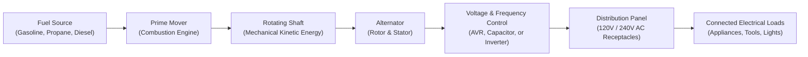
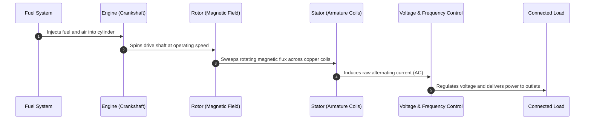
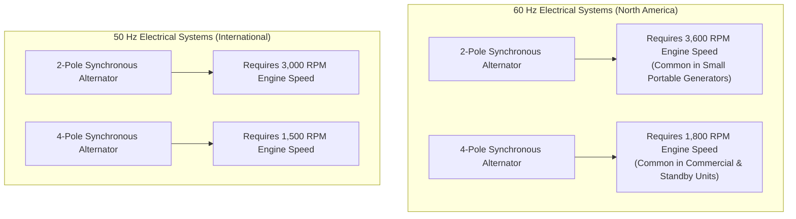
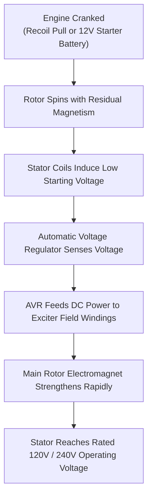
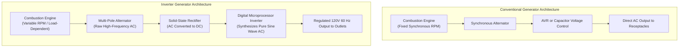
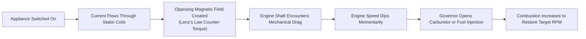
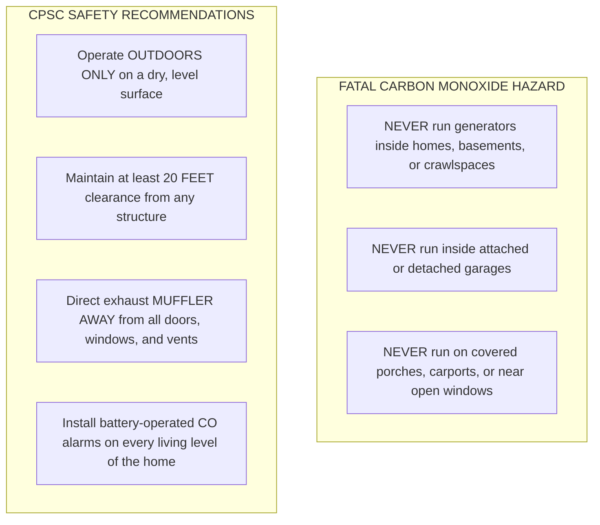

# Editorial Draft: How Does a Generator Work?

> **Document Status:** Complete Pre-Release Draft (Unpublished)  
> **Target Release Window:** Post-Freeze (After November 1, 2026)  
> **Proposed Future Route:** `/how-does-a-generator-work` (Not active in application routing or sitemap)  
> **Target Topical Cluster:** `generators` (Generators & Outage Backup)  
> **Parent Interactive Tool:** [`/generator-size-calculator`](https://calcmypower.com/generator-size-calculator)  
> **Companion Editorial Guides:** [`/how-much-gas-does-a-generator-use`](https://calcmypower.com/how-much-gas-does-a-generator-use), [`/what-size-generator-do-i-need-for-my-house`](https://calcmypower.com/what-size-generator-do-i-need-for-my-house), [`/what-size-generator-to-run-a-refrigerator`](https://calcmypower.com/what-size-generator-to-run-a-refrigerator), [`/continuous-power-generators`](https://calcmypower.com/continuous-power-generators)  

---

## SEO Specification & Metadata

- **Primary Keyword:** `how does a generator work` (US Search Volume: 3,600 | KD: 25)
- **Secondary Supporting Keywords:**
  - `how does an electric generator work` (US Search Volume: 320 | KD: 27)
  - `how does a portable generator work` (US Search Volume: 260 | KD: 26)
  - `how does a generator work without electricity` (US Search Volume: 50 | KD: 1)
  - `how does a generator work step by step` (US Search Volume: 20 | KD: Unranked)
- **Search Intent:** Informational and conceptual educational intent. Users want an accessible, technically grounded explanation of how mechanical energy becomes alternating current (AC) electricity, how portable and inverter models operate, and how units generate power without grid electricity.
- **Suggested Article Title (H1):** How Does a Generator Work? Engine, Alternator, and Electricity Explained
- **Proposed Meta Title:** How Does a Generator Work? Engine, Alternator & Power Explained
- **Proposed Meta Description:** Learn how generators convert mechanical motion into electricity through electromagnetic induction. Explore engines, alternators, inverters, and safe operation.
- **Reading Time:** Approximately 10 minutes (1,900 words)
- **Target Audience:** US homeowners preparing for storm outages, RV owners, campers, jobsite operators, and curious readers seeking an engineering explanation without academic jargon.

---

# How Does a Generator Work? Engine, Alternator, and Electricity Explained

An electric generator does not create electricity out of thin air. Instead, it converts mechanical energy into electrical energy using the scientific principle of electromagnetic induction.

A combustion engine burns fuel to spin a shaft. That spinning shaft turns a magnetic field past insulated copper wire coils inside an alternator. The moving magnetic field forces electrons through the wire, producing electrical current.

---

## The Core Principle: Electromagnetic Induction Explained

Generators operate on the law of conservation of energy. Energy cannot be created or destroyed, only transformed from one state to another.

In 1831, British scientist Michael Faraday discovered electromagnetic induction. He proved that moving a magnetic field across a closed loop of copper wire causes an electric current to flow.

When a magnetic field sweeps across a stationary electrical conductor, it exerts physical force on the electrons in that metal. This movement creates an electrical potential difference, measured in volts.

When you connect an appliance to complete the circuit, those displaced electrons flow through the wire as current, measured in amps. The magnitude of the generated voltage depends on three physical factors:

1. The speed at which the magnetic field rotates past the wire coils.
2. The strength of the magnetic field.
3. The number of wire loops bundled inside the coils.

Because the mechanical shaft turns continuously, the magnetic polarity switches back and forth with every rotation. This continuous reversal produces alternating current (AC), the primary form of electricity used in homes.

---

## How a Generator Works Step by Step

Every engine-driven electrical generator transforms energy through five sequential stages:

### 1. Fuel Powers the Prime Mover
The process begins when an internal combustion engine burns fuel such as gasoline, liquid propane, or diesel. Piston movement inside the engine cylinder turns a steel crankshaft, generating mechanical rotational energy.

### 2. The Rotating Shaft Drives the Alternator
The engine crankshaft connects directly or through a tapered coupler to the alternator rotor shaft. The speed required depends directly on the electrical frequency and the number of magnetic poles in the alternator.

### 3. The Rotor Generates a Moving Magnetic Field
The rotor sits inside the alternator and acts as a rotating magnetic assembly. As the rotor spins, its North and South magnetic poles sweep past stationary coils at high speed.

### 4. The Stator Induces Usable Electric Current
The stator is a stationary cylinder constructed of slotted steel laminations wound with copper coils. When the rotor magnetic flux cuts across these stator windings, electromagnetic induction pushes electrons through the copper, creating alternating current.

### 5. Controls Regulate Voltage and Deliver Power
Raw electrical output passes through voltage-control components, such as an automatic voltage regulator, a resonant capacitor, or an electronic inverter. The system stabilizes output before sending power to panel receptacles, circuit breakers, and connected home appliances.

---

## Generator Speed, Frequency, and Pole Count

In conventional synchronous generators, electrical output frequency is locked directly to shaft rotational speed and the number of magnetic poles.

Engineers calculate synchronous rotational speed using the standard frequency formula:

$$N = \frac{120 \times f}{P}$$

In this formula, $N$ represents the shaft rotational speed in revolutions per minute (RPM). The variable $f$ is the target electrical frequency in Hertz (Hz), and $P$ is the number of magnetic poles built into the alternator.

In North America, household electricity alternates at 60 cycles per second (60 Hz). A conventional two-pole synchronous generator must spin at exactly 3,600 RPM to maintain 60 Hz:

$$N = \frac{120 \times 60}{2} = 3,600\text{ RPM}$$

A four-pole alternator requires half that rotational speed, running at 1,800 RPM to produce the identical 60-Hz frequency:

$$N = \frac{120 \times 60}{4} = 1,800\text{ RPM}$$

Many residential standby generators and heavy commercial sets use four-pole alternators running at 1,800 RPM. Lower engine speeds reduce mechanical friction, operating sound, and long-term component wear compared to high-speed 3,600-RPM engines.

A mechanical or electronic governor regulates fuel delivery to maintain this target speed as electrical loads switch on and off. If the engine bogs down under excessive load, both output voltage and frequency dip.

---

## Main Generator Components and Architecture

A generator combines mechanical, electrical, thermal, and electronic systems into a single self-contained power plant.

| Component | Primary Function | System Role | Common Design Variations |
| :--- | :--- | :--- | :--- |
| **Engine (Prime Mover)** | Burns fuel to deliver rotational mechanical power | Mechanical Drive | Single-cylinder OHV (portable) to multi-cylinder V-twin or liquid-cooled inline (standby) |
| **Alternator (Rotor & Stator)** | Converts rotating mechanical motion into alternating current | Electrical Conversion | Brushed with slip rings, brushless with exciter armature, or multi-pole flywheel assembly |
| **Voltage Regulation System** | Modulates electrical output to maintain steady operating voltage | Power Regulation | Electronic Automatic Voltage Regulator (AVR), resonant capacitor, or solid-state inverter |
| **Fuel Delivery System** | Stores and meters fuel into the combustion chamber | Fuel Delivery | Carbureted gasoline tank, dual-fuel LPG regulator, or dedicated natural gas line |
| **Cooling & Exhaust System** | Dissipates engine heat and vents toxic combustion gases | Thermal & Life Safety | Forced-air cooling fan, liquid radiator, spark-arresting muffler, and exhaust pipe |
| **Lubrication System** | Circulates oil to minimize engine bearing and cylinder wear | Engine Protection | Splash lubrication (small portables) or pressurized oil pump with spin-on filter (standby) |
| **Control Panel & Outlets** | Provides user interface, metering, and circuit protection | Power Distribution | Duplex 120V 20A receptacles, 120/240V twist-lock outlets, USB ports, and push breakers |

The engine and alternator are the two primary functional assemblies. The engine provides mechanical motion, while the alternator converts that motion into usable electrical potential.

---

## How Does a Generator Work Without Grid Electricity?

Many homeowners wonder how a generator creates electricity when the regional power grid is completely dark. A standalone generator produces its own current using internal self-excitation or permanent magnets.

In many synchronous brushless alternators, the rotor steel laminations retain a faint magnetic field after the unit shuts down. Electrical engineers refer to this property as residual magnetism or magnetic remanence.

When the engine spins the shaft, this residual magnetic field sweeps past the stator coils, inducing a small initial voltage. The automatic voltage regulator (AVR) senses this initial voltage and feeds direct current (DC) into the exciter field windings.

This excitation current strengthens the rotor electromagnet, which in turn induces higher voltage in the stator windings. Within seconds, this positive feedback loop stabilizes at the generator rated operating voltage.

Excitation systems vary significantly by manufacturer and generator category:

- **Brushed Alternators with AVR:** Use carbon brushes riding on rotating copper slip rings to deliver DC current directly to the rotor coils.
- **Brushless Alternators with Rotating Diodes:** Use a separate exciter armature and shaft-mounted diodes to convert AC to DC on the spinning shaft, eliminating slip rings and brushes.
- **Capacitor-Regulated Alternators:** Many economy portable generators use an auxiliary stator winding and a power capacitor to regulate voltage through magnetic saturation, using no electronic AVR.
- **Permanent Magnet Alternators (PMA):** Many compact inverter generators use high-strength permanent magnets embedded directly into the engine flywheel, requiring no field excitation current to start generating power.

Starting mechanisms also differ. Manual recoil-start generators require no battery because an engine magneto generates ignition spark mechanically as you pull the cord. Electric-start and automatic standby models require an onboard 12-volt battery to turn the starter motor and power electronic control modules.

Operating without grid power does not mean every generator model can run without a battery. Always verify if a specific unit requires a charged starting battery to operate.

---

## Voltage Regulation vs. Inverter Power Electronics

Conventional synchronous generators and digital inverter generators handle voltage and waveform control through fundamentally different technologies.

### Automatic Voltage Regulation in Conventional Generators
An automatic voltage regulator (AVR) monitors output voltage at the generator terminals. When electrical load increases and causes terminal voltage to drop, the AVR increases DC excitation current to the rotor.

This stronger magnetic field restores output voltage to its nominal target. However, an AVR regulates only voltage magnitude. It does not reshape the alternating current waveform or control electrical frequency.

Frequency remains tied strictly to engine rotational speed. In conventional units, total harmonic distortion (THD), operating sound, and fuel consumption vary widely depending on alternator design, engine displacement, and connected load.

### Inverter Generator Power Electronics
An inverter generator decouples electrical output from engine speed using a multi-stage digital conversion process.

First, the engine drives a multi-pole alternator, often integrated into the engine flywheel. This alternator produces raw, high-frequency multi-phase AC power across a wide range of engine speeds.

Next, a solid-state rectifier converts that raw AC into direct current (DC). Finally, a microprocessor-controlled inverter module converts the DC power back into clean, smooth alternating current at 120 volts and a precise 60 Hz.

Because output frequency is synthesized electronically, the engine does not need to spin at a fixed 3,600 RPM. When electrical demand is light, an electronic throttle drops engine speed to reduce fuel consumption and acoustic noise.

### Power Quality and Sensitive Equipment
Power quality, noise, and fuel economy vary substantially by individual model, load level, and manufacturer engineering:

- **Harmonic Distortion:** Total harmonic distortion (THD) measures how closely an AC waveform resembles a pure mathematical sine wave. Inverter generators are engineered to maintain low THD, often specified below 3% to 5% at rated load. Conventional portable generators exhibit higher distortion that varies with load type.
- **Fuel Efficiency:** Variable-speed inverter generators adjust fuel consumption to match demand. For example, Honda publishes that its Eco-Throttle system can achieve up to 40% greater fuel efficiency under specific light-load test conditions compared to conventional fixed-speed models.
- **Operating Noise:** Sound levels depend on engine displacement, acoustic dampening enclosures, and operating load. Enclosed inverter generators typically operate at lower sound levels during partial-load conditions than open-frame conventional generators.
- **Sensitive Equipment:** Microprocessor-controlled furnaces, variable-speed power tools, and high-end audio gear often operate more reliably on low-THD power. For medical devices such as CPAP units or concentrators, always follow the medical equipment manufacturer power specifications rather than assuming any generator category is universally compatible.

---

## Portable, Standby, and RV Generators: Key Operational Differences

Generators share the same electromagnetic core, but their installation, fuel delivery, and transfer mechanisms vary based on application.

```mermaid
flowchart TD
    subgraph Portable["Portable Generator Setup"]
        P1["Manual Transport to Outdoors<br>(CPSC Minimum 20-Foot Clearance)"] --> P2["Heavy-Duty Extension Cords<br>or Generator Inlet Box"]
        P2 --> P3["Manual Transfer Switch<br>or Direct Receptacles"]
    end

    subgraph Standby["Permanent Standby Setup"]
        S1["Permanently Installed Outdoor Pad<br>(Piped Natural Gas or Propane)"] --> S2["Automatic Transfer Switch (ATS)<br>(Monitors Utility Grid Line)"]
        S2 --> S3["Outage Confirmation Delay<br>Automatic Transfer (10 to 30 Seconds)"]
    end

    subgraph RV["RV Generator Setup"]
        R1["Built-In Compartment or Portable<br>(Vibration Dampened)"] --> R2["Vehicle Fuel Tank or Separate LPG<br>(Gasoline, Diesel, or Propane)"]
        R2 --> R3["30A (120V) or 50A (120/240V)<br>RV Distribution Panel"]
    end
```

### Portable Generators
Portable generators feature wheels and handles for manual transport. They store gasoline or connect to portable propane cylinders, delivering electricity through faceplate receptacles.

Operators deploy portable units outdoors during power outages. They connect appliances using heavy-duty outdoor extension cords or plug into an exterior power inlet box wired to a manual transfer switch.

To calculate how much gasoline a portable generator uses under load, review our [Generator Fuel Consumption Guide](https://calcmypower.com/how-much-gas-does-a-generator-use) or estimate operating hours with our [Generator Fuel Consumption Calculator](https://calcmypower.com/generator-fuel-consumption-calculator).

### Standby Home Generators
Standby generators sit permanently on an outdoor concrete or composite pad. They connect directly to the home electrical service through an Automatic Transfer Switch (ATS).

These units typically connect to a municipal natural gas line or a large stationary propane tank. When utility power fails, an electronic controller detects the voltage loss, waits a programmed confirmation delay (often 2 to 10 seconds to ignore momentary flickers), starts the engine, and transfers electrical loads.

The complete transfer cycle typically takes 10 to 30 seconds, depending on controller programming and cold-weather engine warm-up settings. Sizing a standby system requires evaluating continuous household demand and motor startup surges, as detailed in our guide on [What Size Generator Do I Need for My House?](https://calcmypower.com/what-size-generator-do-i-need-for-my-house).

### RV and Mobile Generators
RV power setups use either built-in generators (such as commercial chassis units tapped directly into the vehicle fuel tank) or standalone portable inverter generators.

They supply 120-volt 30-amp or 120/240-volt 50-amp electricity to run rooftop air conditioners, kitchen appliances, and onboard battery converters while camping off-grid.

---

## What Happens When You Connect an Electrical Load?

A generator does not encounter the same physical resistance when powering a lightbulb as it does when running a large motor. Electrical load creates physical mechanical resistance on the engine shaft.

When you switch on an appliance, current flows through the stator copper windings. According to Lenz's law, this electrical current produces an opposing magnetic field.

This opposing field pushes back against the spinning rotor electromagnet, creating counter-electromotive torque. This counter-torque acts like a mechanical brake on the engine crankshaft.

The engine encounters mechanical drag and begins to slow down. An engine governor detects the drop in speed and opens the fuel throttle, admitting more fuel and air into the combustion chamber.

Combustion produces more horsepower, restoring target operating speed. This mechanical response is why a generator engine changes tone and works noticeably harder when heavy loads turn on.

### Resistive Loads vs. Electric Motor Inrush Current
Different appliances draw power in distinctly different ways:

- **Resistive Loads:** Light bulbs, electric space heaters, toasters, and water heaters convert electricity into heat or light. Current and voltage remain in phase. These devices draw steady power with no elevated startup surge.
- **Inductive Motor Loads:** Refrigerators, air conditioners, well pumps, and compressors rely on electric induction motors. When a motor is energized from a dead stop, its stationary rotor develops zero back-electromotive force (back EMF).

Until the rotor accelerates toward normal operating speed, the motor draws elevated locked-rotor inrush current. This starting current depends on motor design, NEMA code letter, and mechanical starting resistance, frequently reaching several times the motor continuous running current.

### Worked Example: Loading a 3,500-Watt Generator
Consider an illustrative scenario with a generator rated for 3,500 continuous running watts and 4,000 maximum surge watts:

1. **Continuous Base Load:** The home operates LED lighting (100 watts), an internet router (20 watts), and a television (150 watts), totaling 270 continuous running watts. The engine operates under minimal counter-torque.
2. **Refrigerator Starts (Illustrative Values):** Suppose a specific refrigerator requires 700 continuous running watts and draws a momentary inrush surge of 2,100 watts during compressor startup.
3. **Surge Impact:** At the instant the compressor starts, total electrical demand spikes to $270\text{ W} + 2,100\text{ W} = 2,370\text{ W}$.
4. **Governor Response:** The engine experiences counter-electromotive torque, drops slightly in speed, and the governor increases throttle to supply the surge within the generator 4,000-watt surge rating.
5. **Settled Running State:** Once the compressor reaches operating speed, demand drops to $270\text{ W} + 700\text{ W} = 970\text{ W}$. The engine settles into a steady running tone.

Actual appliance wattage varies widely. Always verify equipment nameplate ratings rather than assuming all refrigerators draw 700 watts.

To convert between appliance operating current and wattage, use our [Watts to Amps Electrical Calculator](https://calcmypower.com/watts-to-amps-calculator). For comprehensive refrigerator startup calculations, read our guide on [What Size Generator to Run a Refrigerator](https://calcmypower.com/what-size-generator-to-run-a-refrigerator).

---

## Critical Generator Safety and Code Compliance

Combustion generators produce electrical energy alongside hazardous exhaust byproducts. Safe operation requires strict adherence to manufacturer instructions and electrical safety standards.

### 1. Carbon Monoxide and Outdoor Placement
Internal combustion engines produce exhaust containing carbon monoxide (CO). Carbon monoxide is a colorless, odorless, and tasteless gas that can cause severe injury or death within minutes.

The U.S. Consumer Product Safety Commission (CPSC) recommends operating portable generators outdoors only, positioned at least 20 feet away from homes, doors, windows, and fresh-air intake vents.

Always direct the engine exhaust muffler away from occupied buildings. Never run a generator inside a home, basement, crawlspace, shed, or garage, even if doors and windows are left wide open.

### 2. Preventing Fatal Backfeeding
Never connect a portable generator directly into a standard household wall outlet using a double-male plug cord, commonly called a "suicide cord." This dangerous practice is known as backfeeding.

Backfeeding bypasses your home circuit protection and sends electricity backward through the utility transformer. This energizes downed neighborhood power lines at thousands of volts, creating a severe electrocution hazard for utility line workers.

Safe connection to household wiring requires approved transfer equipment installed by a qualified electrician in accordance with local electrical codes and NFPA 70 / National Electrical Code (NEC) standards:

- **Manual Transfer Switch:** A dedicated subpanel that mechanically breaks the utility connection before connecting generator power to selected household circuits.
- **Mechanical Panel Interlock:** A listed sliding bracket installed on the main service panel that physically prevents the utility main breaker and the generator backfeed breaker from being turned on simultaneously.

For details on continuous duty ratings and safe backup capacity, consult our reference on [Continuous Power Generators](https://calcmypower.com/continuous-power-generators).

### 3. Weather Protection and Safe Refueling
Operating a generator in rain or standing water introduces severe electrical shock and electrocution hazards. Do not use makeshift tarps or boxes that trap heat or restrict cooling airflow.

Use purpose-built, listed running covers or weather shelters designed specifically for portable generator airflow and moisture protection, following manufacturer instructions.

Never add fuel while the engine is running or hot. Gasoline spilled on hot engine surfaces can ignite instantly. Turn off the generator and allow the engine to cool down in accordance with the manufacturer user manual before opening the fuel cap.

---

## Frequently Asked Questions

### How does a generator work step by step?
A generator works through five stages: an engine burns fuel to produce mechanical rotation; the spinning shaft drives an alternator rotor; the rotor sweeps a magnetic field past stationary copper stator coils; electromagnetic induction pushes electrons through the wire coils; and voltage regulation controls stabilize the resulting alternating current for connected appliances.

### How does an electric generator produce electricity?
An electric generator produces electricity through electromagnetic induction, a physical principle discovered by Michael Faraday in 1831. When a magnetic field moves past an electrical conductor, magnetic forces push electrons along the wire. A generator continuously spins magnets past tightly wound copper coils, generating an ongoing flow of alternating electrical current.

### How does a portable generator work?
A portable generator combines a compact combustion engine with an alternator inside a steel frame. The engine burns fuel to rotate a drive shaft at an operating speed determined by alternator pole count (such as 3,600 RPM for a two-pole 60-Hz unit). This spinning motion induces alternating current in stator coils, which is delivered through faceplate outlets.

### Can a generator work without grid electricity?
Yes. An engine-driven generator is a self-contained power unit that operates independently of the utility grid. It establishes its magnetic field using residual magnetism in its rotor iron core or permanent magnets. A manual recoil pull cord starts the engine mechanically without requiring utility power, though electric-start models require an onboard battery.

### What is the difference between a conventional and an inverter generator?
A conventional generator uses an alternator tied to synchronous engine speed (typically 3,600 RPM for two-pole 60-Hz sets) with voltage controlled by an AVR or capacitor. An inverter generator produces raw multi-phase AC, rectifies it to DC, and uses digital microprocessor electronics to synthesize pure sine wave AC, allowing the engine to throttle down at light loads.

### How does a generator supply power to a house safely?
A generator supplies power to a house safely through a code-compliant transfer switch or mechanical panel interlock installed by a qualified electrician. These devices physically isolate the home electrical system from the outside utility grid before connecting generator power, preventing hazardous backfeeding onto neighborhood power lines.

---

## Internal Linking & Context Plan

The following table documents verified internal links to live CalcMyPower tools and guides. Every destination URL has been confirmed active via direct HTTPS testing.

| Target Route | Route Type | Proposed Anchor Text | Context & Location in Article | Live HTTP Status |
| :--- | :--- | :--- | :--- | :---: |
| `/generator-size-calculator` | Calculator | `Generator Size Calculator` | Header metadata and Section 6 link for planning generator capacity | `200 OK` |
| `/generator-fuel-consumption-calculator` | Calculator | `Generator Fuel Consumption Calculator` | Section 6 link for estimating fuel logistics and tank runtimes | `200 OK` |
| `/how-much-gas-does-a-generator-use` | Guide | `Generator Fuel Consumption Guide` | Section 6 contextual reference for fuel consumption rates by wattage | `200 OK` |
| `/what-size-generator-do-i-need-for-my-house` | Guide | `What Size Generator Do I Need for My House?` | Section 6 reference for standby home generator sizing methodology | `200 OK` |
| `/what-size-generator-to-run-a-refrigerator` | Guide | `What Size Generator to Run a Refrigerator` | Section 7 reference for motor surge and refrigerator startup loads | `200 OK` |
| `/how-to-calculate-watts-for-a-generator` | Guide | `Generator Wattage Calculation Guide` | Section 7 companion link for tallying running and surge watts | `200 OK` |
| `/continuous-power-generators` | Guide | `Continuous Power Generators` | Section 8 reference for continuous duty ratings and code guidelines | `200 OK` |
| `/watts-to-amps-calculator` | Calculator | `Watts to Amps Electrical Calculator` | Section 7 reference for converting electrical current and wattage | `200 OK` |
| `/ups-battery-backup-calculator` | Calculator | `UPS Battery Backup Calculator` | Section 5 comparison note on battery storage vs engine generators | `200 OK` |
| `/calculators` | Hub Directory | `Power and Energy Calculators Directory` | Concluding navigation for exploring companion electrical calculators | `200 OK` |

---

## Verified Technical Sources & Bibliography

All technical explanations, safety guidelines, and operating principles in this draft are grounded in official documentation:

1. **U.S. Energy Information Administration (EIA):** *Electricity explained: How electricity is generated*  
   URL: `https://www.eia.gov/energyexplained/electricity/how-electricity-is-generated.php`  
   *Supported Claims:* Mechanical-to-electrical energy conversion principle, role of prime movers, electromagnetic induction discovery by Michael Faraday (1831), and rotor-stator geometry.

2. **U.S. Consumer Product Safety Commission (CPSC):** *Carbon Monoxide Information Center & Generator Safety*  
   URL: `https://www.cpsc.gov/Safety-Education/Safety-Education-Centers/Carbon-Monoxide-Information-Center/Generators`  
   *Supported Claims:* Authoritative recommendation for 20-foot outdoor placement distance, directing exhaust away from doors/windows/vents, and risks of carbon monoxide poisoning in enclosed or partially enclosed spaces.

3. **Occupational Safety and Health Administration (OSHA):** *Grounding Requirements for Portable Generators FactSheet*  
   URL: `https://www.osha.gov/publications/generator-safety-factsheet`  
   *Supported Claims:* Prohibition of backfeeding into building electrical wiring, electrocution risks to utility lineworkers, and isolation via approved transfer switches.

4. **National Fire Protection Association (NFPA):** *NFPA 70: National Electrical Code (NEC), Article 702 (Optional Standby Systems)*  
   URL: `https://www.nfpa.org/codes-and-standards/nfpa-70-standard-roster`  
   *Supported Claims:* Technical requirement for transfer equipment that prevents inadvertent interconnection of normal utility and alternate generator sources.

5. **Honda Power Equipment Technical Documentation:** *Honda Inverter Generator Technology & Eco-Throttle Systems*  
   URL: `https://powerequipment.honda.com/generators/inverter-generator-technology`  
   *Supported Claims:* Multi-pole alternator design, AC-to-DC rectification, microprocessor pure sine wave inversion, and Honda-specific claim of up to 40% fuel efficiency improvement under light-load operating conditions.

6. **Institute of Electrical and Electronics Engineers (IEEE):** *IEEE Guide for AC Generator Protection (IEEE Std C37.102)*  
   URL: `https://standards.ieee.org/ieee/C37.102/4799/`  
   *Supported Claims:* Synchronous speed equation ($N = \frac{120 \times f}{P}$), residual magnetic remanence field buildup, and counter-electromotive torque (Lenz's law) during electrical loading.
